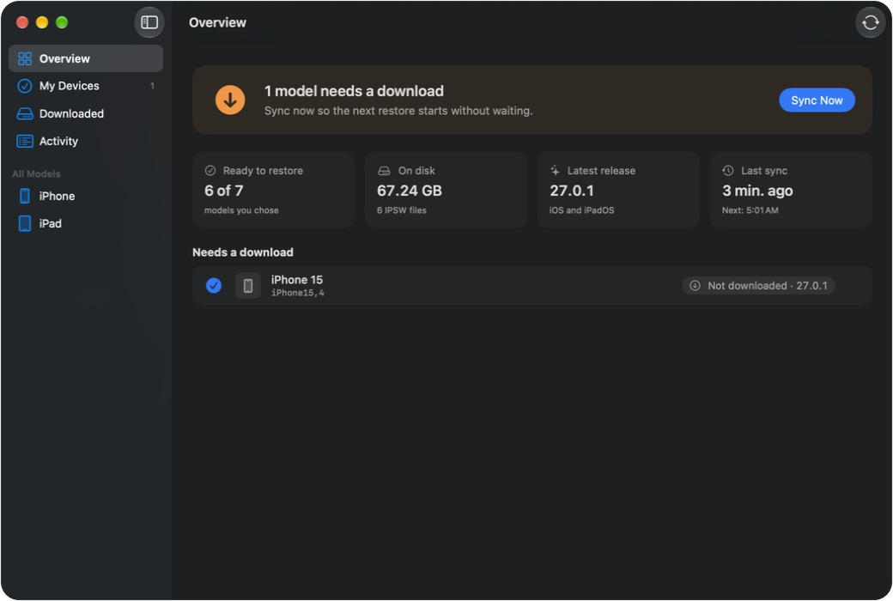
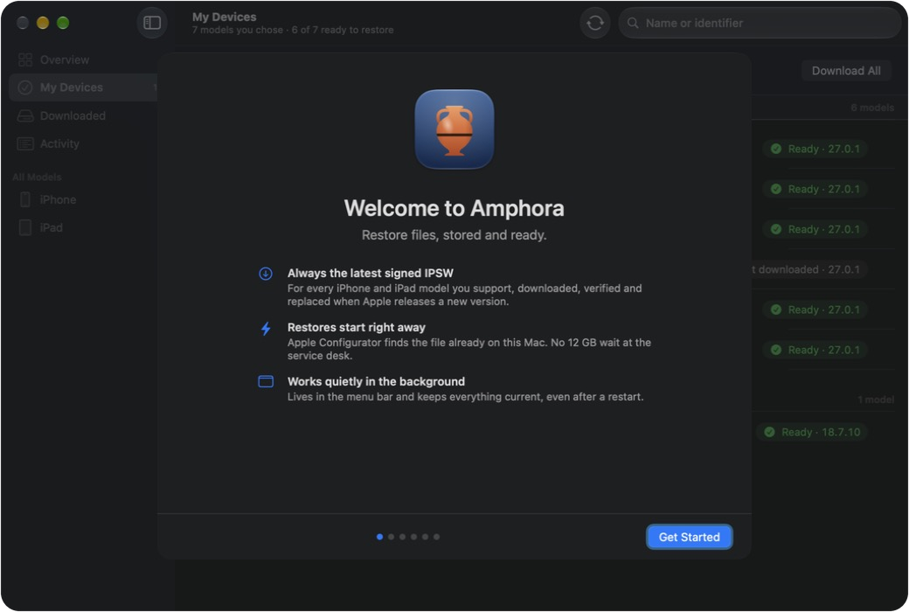
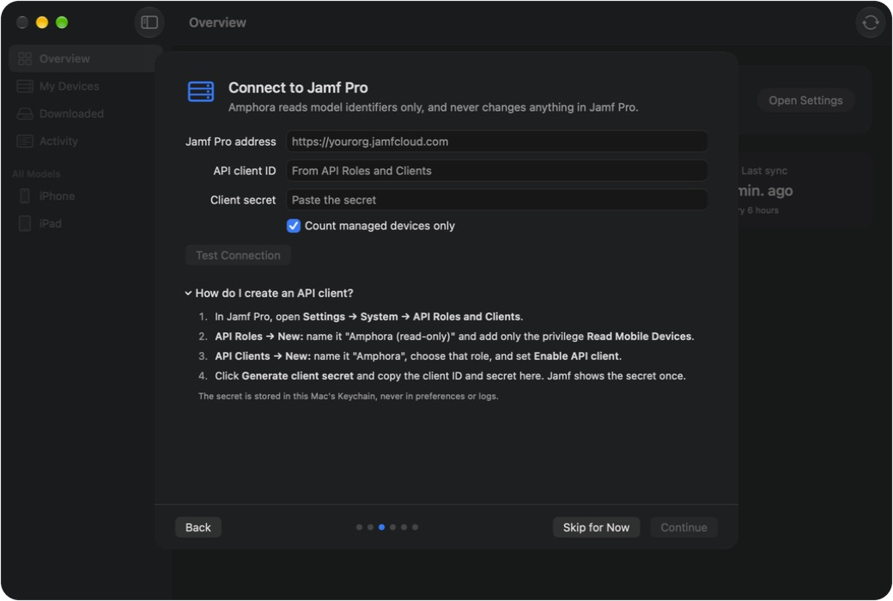
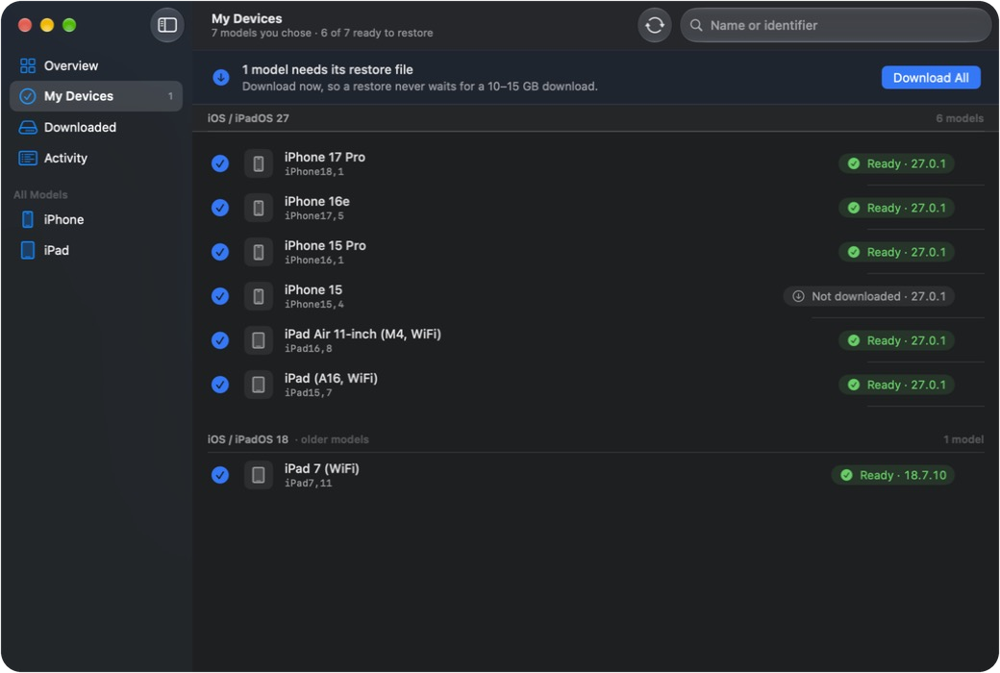
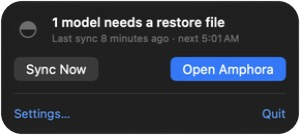

<p align="center"></p>

# Amphora

**IPSW restore files, stored and ready.** Amphora keeps the latest signed iOS, iPadOS and macOS restore files on your service desk Mac, so restoring an iPhone, iPad or Apple silicon Mac never starts with a 12–27 GB download.

*An amphora is the painted Greek jar made to keep what you'll need later. The project comes from [Techne](https://techne.consulting): τέχνη, craft.*

Free and open source (MIT). Built by an Apple admin, for Apple admins.

> **Status: early, in daily use.** Curated, on-demand and Jamf Pro modes work, and restores from Apple Configurator's cache are tested on Apple silicon Macs. Builds are universal; Intel Macs are untested so far. See the [roadmap](#roadmap).

<p align="center"></p>

## What it does

1. Reads the current iOS, iPadOS and macOS releases from [SOFA](https://sofa.macadmins.io), the MacAdmins community feed.
2. Works out, for each model you care about, the latest release of the newest OS that still supports it.
3. Finds the signed IPSW for that release and downloads it. Interrupted downloads resume.
4. Verifies every file against its published SHA-256 before using it.
5. Deletes IPSWs your models no longer need, but **only after every download succeeded**, so you're never left without a usable file.

Several models usually share one IPSW, so 40 models might need only 15 files.

**Macs:** every Apple silicon Mac restores from the same file for a given macOS version (`UniversalMac_…_Restore.ipsw`, about 27 GB), so a whole Mac fleet usually needs one file; a brand-new model can need its own build for its first weeks. Restore them in Apple Configurator over USB-C, in DFU mode. Intel Macs can't be restored from an IPSW (they reinstall from macOS Recovery), so Amphora skips them.

## What it deletes

Pick a **dedicated folder** for Amphora. During a sync it deletes any `.ipsw` file in that folder that the selected models don't need. It never touches other file types, and in Apple Configurator's cache it only removes files it placed there itself.

On-demand downloads of a model you haven't ticked are removed at the next sync.

With the Jamf Pro inventory, a model whose last device leaves Jamf Pro keeps its file for **14 days** before it's deleted, so removing a device record before you restore the device doesn't cost you the file. Change it in Settings → Models (0 deletes at the next sync).

## Install

**App:** download `Amphora-<version>.pkg` from [Releases](../../releases). It installs Amphora in `/Applications` and the `amphora` command in `/usr/local/bin`. Releases are signed with Developer ID and notarized by Apple. To deploy with Jamf Pro, see [below](#deploying-with-jamf-pro).

On first launch, a setup assistant walks you through choosing your models (from Jamf Pro or by hand), connecting the Jamf Pro API client, granting Full Disk Access for Apple Configurator, and how Amphora runs in the background.

<p align="center">
  
  
</p>

**Command line:**

```sh
swift build -c release
.build/release/amphora models --filter "iPhone 15"
.build/release/amphora sync --models iPhone16,1,iPhone16,2,iPad14,3 --dry-run
```

```text
amphora sync   --models <id,id,...> [--store <dir>] [--no-prune] [--configurator] [--dry-run]
amphora sync   --from-jamf          [--include-unmanaged] [--keep-removed-days <n>] [same options as above]
amphora jamf   [--include-unmanaged]
amphora get    <model-identifier>   [--store <dir>] [--configurator]
amphora plan   --models <id,id,...> [--store <dir>]
amphora models [--filter <text>]
```

The default folder is `/Users/Shared/Amphora`.

## Using the app

<p align="center"></p>

- **My Devices** is your fleet: models from Jamf Pro, or the ones you tick under **All Models**. Each shows whether its restore file is ready.
- **Older models** that current releases dropped keep the final release Apple still signs for them (above: iPad 7 on iPadOS 18.7.10).
- **Runs in the background.** Amphora opens at login and lives in the menu bar; closing the window keeps it syncing (every 6 hours by default, and at launch when a sync is due). Downloads keep the Mac from idle sleep until they finish. A Mac that's asleep can't sync: Amphora catches up within 15 minutes of waking. On a service desk Mac, consider letting only the display sleep. **Sync Now** (⌘R) any time.
- **Download now** (↓ on any row) fetches one model immediately. Use it for the odd device that walks in.
- **Restore:** with Full Disk Access (below), IPSWs are placed in Apple Configurator's cache and its restores start without a download. Without it, drag a model (or a file from **Downloaded**) onto the device in Configurator.
- **Downloaded** lists every IPSW on disk. Select files and press Delete to remove them; you're told which models use a file first.
- **Settings** → choose the folder, turn cleanup on or off, and see whether the Apple Configurator cache is working.
- **Menu bar:** an amphora that fills up as your models' restore files become ready (and rises during downloads), with a badge when something needs you. Click it for the status and Sync Now while the window is closed.

<p align="center"></p>

Model identifiers are the ones Jamf Pro shows as *Model Identifier* (for example `iPhone16,1`).

## Jamf Pro

Instead of ticking models by hand, let Jamf Pro decide: Amphora keeps every iPhone and iPad model in your inventory current, and drops IPSWs for models you no longer have. Turn on **Include Apple silicon Macs** in Settings to cover your Macs too.

Amphora reads the inventory at the start of every sync: at launch, every 6 hours by default (1–24 in Settings), and whenever you click **Sync Now**. A new model is downloaded in that same sync. A model that's gone keeps its file for 14 days (configurable), then the next sync deletes it. Amphora tracks models, not devices: a fifth iPhone 15 changes nothing, the first iPhone 17 does.

1. In Jamf Pro → Settings → **API Roles and Clients**, create a role with only **Read Mobile Devices** (add **Read Computers** to include Macs).
2. Create an API client with that role, enable it, and generate a client secret.
3. In Amphora → Settings → Models, choose **Jamf Pro inventory**, enter the address, client ID and secret, and click **Test Connection**.

What it does and doesn't do:

- Reads model identifiers only (and whether each device is managed). No serial numbers, users or locations are stored.
- Never writes anything to Jamf Pro.
- The secret lives in your login Keychain, never in preferences or logs.
- If Jamf Pro can't be reached, or returns no devices, Amphora keeps using the last good inventory and deletes nothing because of it.
- Older models that current releases dropped keep the final release Apple still signs. Models Apple signs nothing for are listed in Settings and skipped.

From the command line, set `JAMF_URL`, `JAMF_CLIENT_ID` and `JAMF_CLIENT_SECRET` (or save the secret once in the app) and run `amphora sync --from-jamf`. It keeps removed models' files for 14 days as well (`--keep-removed-days <n>`); the history is stored in the download folder.

## Deploying with Jamf Pro

[docs/DEPLOYING.md](docs/DEPLOYING.md) covers the package, the Full Disk Access profile each release ships with, managed settings and login items.

## Managed settings

Settings live in the `consulting.techne.amphora` preference domain, so an MDM configuration profile can set them. Values set by a profile show as locked in the app.

| Key | Type | Meaning |
| --- | --- | --- |
| `ModelSource` | string | `curated` (models ticked in the app) or `jamf` (Jamf Pro inventory) |
| `SelectedModels` | array of strings | Model identifiers to keep current in `curated` mode |
| `JamfURL` | string | Jamf Pro address, e.g. `https://yourorg.jamfcloud.com` |
| `JamfClientID` | string | API client ID. The secret is entered once in the app and kept in the Keychain |
| `JamfManagedDevicesOnly` | boolean | Count only managed devices (default `true`) |
| `JamfIncludeMacs` | boolean | Include Apple silicon Macs from the computer inventory; needs Read Computers (default `false`) |
| `JamfRemovedModelGraceDays` | integer | Days a model's file is kept after its last device leaves Jamf Pro, 0–90 (default `14`; `0` deletes at the next sync) |
| `StorePath` | string | Folder for IPSWs |
| `PruneOldIPSWs` | boolean | Delete IPSWs no longer needed (default `true`) |
| `ExportToConfigurator` | boolean | Place IPSWs in Apple Configurator's cache (default `true`) |
| `SyncIntervalHours` | integer | Hours between automatic syncs: 1, 3, 6, 12 or 24 (default `6`) |
| `ShowInMenuBar` | boolean | Keep running in the menu bar when the window is closed (default `true`) |

Open at login is registered on first launch. On managed Macs, a Managed Login Items payload (bundle ID `consulting.techne.amphora`) keeps users from turning it off.

## Apple Configurator cache and Full Disk Access

Amphora places each verified IPSW in Apple Configurator's firmware cache:

```
~/Library/Group Containers/K36BKF7T3D.group.com.apple.configurator/Library/Caches/Firmware
```

so Configurator's restores start immediately. On APFS the copy is a clone and uses no extra space.

macOS protects that folder. Amphora needs **Full Disk Access** to write there, and macOS does not prompt for it; without it, writes simply fail. The app tells you when that happens.

- **One Mac:** System Settings → Privacy & Security → Full Disk Access → add Amphora, then reopen it.
- **Managed Macs (Jamf Pro):** deploy a Privacy Preferences Policy Control profile:

| Field | Value |
| --- | --- |
| Identifier | `consulting.techne.amphora` |
| Identifier type | Bundle ID |
| Code requirement | output of `codesign -dr - "/Applications/Amphora.app"` |
| App or service | SystemPolicyAllFiles |
| Access | Allow |

The code requirement is only stable for a Developer ID-signed release, so use a released build for the profile.

Full Disk Access is a broad permission. If your security team won't grant it, turn the setting off and drag models onto devices in Configurator instead.

## Privacy and network

Amphora talks only to:

- `sofafeed.macadmins.io` (release data),
- `api.ipsw.me` (download links and checksums),
- Apple's CDN (the IPSWs themselves).

No telemetry and no accounts. Requests carry a `User-Agent` of `Amphora/<version>` so the services can see who's calling.

## Roadmap

- **v0.1 — Usable without Jamf.** Curated and on-demand modes, app and CLI, verify and prune, drag to restore, manual delete.
- **v0.2 — Jamf-driven.** Model list from Jamf Pro inventory through a read-only API client, Keychain storage *(done)*; signed and notarized `.pkg`.
- **v0.3 — Runs on its own, and Macs.** Menu bar, open at login, background sync, notifications *(done)*; Universal Mac IPSWs for Apple silicon Macs *(done)*.
- **Later.** Homebrew cask; a heads-up from SOFA before a release lands.

## Building from source

Requirements: macOS 14+, Xcode 16+, [XcodeGen](https://github.com/yonaskolb/XcodeGen) (`brew install xcodegen`).

```sh
swift test                      # engine tests
cd App && xcodegen && open Amphora.xcodeproj
```

The engine (`Sources/AmphoraCore`) is a Swift package with no UI. The app (`App/`) and the CLI (`Sources/amphora`) are thin layers on top of it.

## Security

Amphora holds a Jamf Pro API secret and uses Full Disk Access, so [SECURITY.md](SECURITY.md) explains exactly what it touches, and how to report a vulnerability privately.

## Credits

- [SOFA](https://sofa.macadmins.io) by the MacAdmins Open Source community, for release data.
- [ipsw.me](https://ipsw.me) for firmware links and checksums.

Please be kind to both: Amphora makes one request at a time and only syncs every few hours.

Development was assisted by [Claude](https://claude.ai), Anthropic's AI model. Design decisions, testing on real devices and releases are by the maintainer.

## License

MIT. See [LICENSE](LICENSE).
